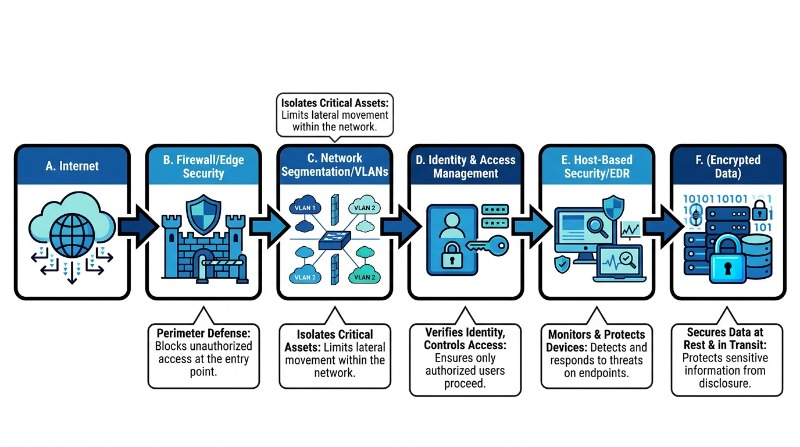
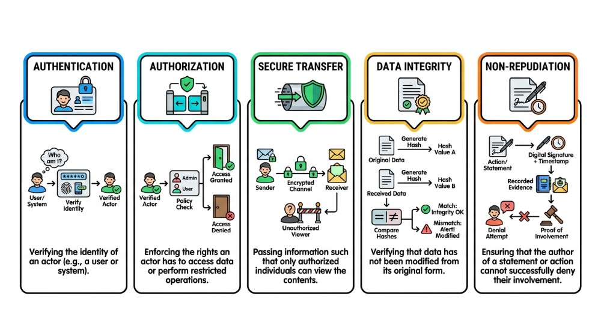

# Computer Security

🖥️ [Slides](https://docs.google.com/presentation/d/1pUU4DDACUndgj_ij7bbKOUY8cxmGinZq/edit#slide=id.p1)

🖥️ [Lecture Videos](#videos)

📖 **Required Reading**: None

### 🔑 Key points

- High-level goals of computer security

---

Software systems conduct trillions of dollars in daily transactions and manage access to billions of personal records. This makes these systems valuable targets for attack. Malicious actors attempt to compromise systems in a variety of ways, such as gaining unauthorized access to data and computers for the purposes of stealing, monitoring, damaging, or otherwise misusing assets. To mitigate these threats, you must include security as a primary design criterion, understand historical and current attack vectors, vigilantly monitor for intrusion, and continually enhance your systems as new threats evolve.


## Fundamental Principles of Defensive Security

Building a resilient security posture requires more than just installing an antivirus or setting a strong password. It involves a multi-layered strategy designed to minimize risk, contain damage, and ensure rapid recovery. The following principles form the foundation of modern computer security.

 ### 1. Minimizing Risk Through Hardening
The **Attack Surface** represents the sum of all points where an unauthorized user can try to enter or extract data from an environment. To reduce this surface, organizations must disable unused services, remove unnecessary software, and limit exposed endpoints. For example, a web server should not have an email client or development tools installed; if they aren't there, an attacker cannot exploit them.

**Secure Defaults** further strengthen this by ensuring that systems are restrictive out of the box. Instead of shipping a device with a "guest" account enabled and all ports open, a secure default configuration requires an administrator to intentionally enable only the specific features required for operation.

### 2. Layering Defenses
**Defense in Depth** is the practice of placing multiple independent safeguards between an attacker and the target data. If one layer fails, others remain to stop the threat. A typical defense-in-depth strategy might look like this:




### 3. Controlling Access and Movement
Two critical concepts in controlling access are **Least Privilege** and **Segmentation**:
*   **Least Privilege:** Users and processes should only have the minimum permissions necessary to perform their tasks. For instance, a marketing intern should not have administrative access to the company's payroll database.
*   **Network Segmentation:** By dividing a network into smaller, isolated sections, you prevent "lateral movement." If an attacker compromises a workstation in the HR department, segmentation prevents them from easily jumping into the Engineering servers.

### 4. Continuous Maintenance and Monitoring
Security is not a "set it and forget it" task. It requires ongoing effort:
1.  **Keep Systems Current:** Regularly apply security patches. Vulnerabilities in outdated software like "Log4j" or old versions of Windows are primary targets for automated exploits.
2.  **Log and Detect:** You cannot stop what you cannot see. Security Information and Event Management (SIEM) tools collect logs to identify suspicious patterns, such as multiple failed login attempts from a foreign IP address.
3.  **Prepare to Recover:** Assume a breach will eventually happen. Maintain encrypted, off-site backups and conduct regular "tabletop exercises" to practice your incident response plan.

### 5. Secure Development Lifecycle (SDLC)
Security should be integrated into the development process rather than being an afterthought. This includes:
*   **Input Validation:** Ensuring that user-provided data is sanitized to prevent SQL Injection or Cross-Site Scripting (XSS).
*   **Dependency Scanning:** Checking third-party libraries for known vulnerabilities.

### 6. Principle of Least Privilege (PoLP)

The Principle of Least Privilege (PoLP) is a foundational concept in computer security which dictates that users, processes, and systems should be granted only the minimum level of access—or permissions—necessary to perform their specific functions. By restricting access rights to the bare essentials required for a task, organizations can significantly reduce their attack surface and minimize the potential for lateral movement during a security breach.


Example of a **Least Privilege** policy for a cloud service that allows only "Read" (GetObject) access to a specific folder, and requires Multi-Factor Authentication (MFA).

```json
{
  "Version": "2012-10-17",
  "Statement": [
    {
      "Effect": "Allow",
      "Action": "s3:GetObject",
      "Resource": "arn:aws:s3:::company-public-reports/*",
      "Condition": {"Bool": {"aws:MultiFactorAuthPresent": "true"}}
    }
  ]
}
```


```masteryls
{"id":"4ea2f11a-4edf-4171-be84-e00492a62e4b","title":"Identifying Security Principles","type":"multiple-choice"}
A company decides to implement a policy where all new employee laptops have the camera and microphone disabled by default, requiring a manager's approval and a manual configuration change to enable them for specific roles. Which security principle does this best represent?

- [ ] Defense in Depth
  You might be thinking of layering, but this specific action describes a starting state. Defense in Depth involves using multiple different types of controls (like a firewall AND encryption) simultaneously. The correct answer is Secure Defaults.
- [x] Secure Defaults
  Exactly! By starting with the most restrictive settings and requiring an intentional action to lower security, the company is following the principle of Secure Defaults to ensure systems are safe out of the box.
- [ ] Least Privilege
  You're close, as this limits what a user can do, but Least Privilege usually refers to user permissions and access rights. Starting a system with features turned off is specifically an example of Secure Defaults.
- [ ] Network Segmentation
  Not quite. Network segmentation involves dividing a network into zones to prevent an attacker from moving between systems. Disabling hardware features on a single device is an example of Secure Defaults.
```

## Applying Cryptography

For the purposes of this course, we focus our security discussion on the application of cryptography for the secure transmission and storage of data. This narrows our focus to the following areas:

- **Authentication**: Verifying the identity of an actor (e.g., a user or system).
- **Authorization**: Enforcing the rights an actor has to access data or perform restricted operations.
- **Secure transfer**: Passing information such that only authorized individuals can view the contents.
- **Data Integrity**: Verifying that data has not been modified from its original form.
- **Non-Repudiation**: Ensuring that the author of a statement or action cannot successfully deny their involvement.



Without modern cryptography it would be extremely difficult to authenticate users, represent their rights and identity, encrypt their data, and digitally sign messages. With cryptography we can secure transactions and be confident in the identity of responsible parties.

In the following topics we will discuss cryptographic hashing and encryption.

## Videos

- 🎥 [Computer Security Overview (7:49)](https://byu.hosted.panopto.com/Panopto/Pages/Viewer.aspx?id=f60bd2e6-9aec-44ba-8e48-b1a8014a2efe) - [[transcript]](https://github.com/user-attachments/files/17736619/CS_240_Computer_Security_Overview_Transcript.pdf)
