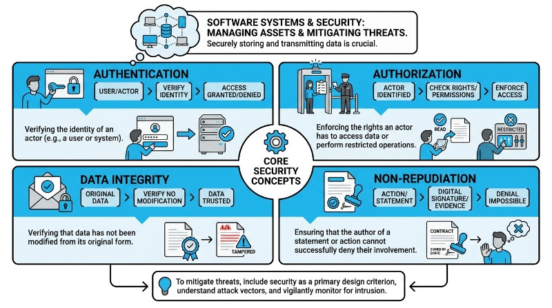

# Computer Security

🖥️ [Slides](https://docs.google.com/presentation/d/1pUU4DDACUndgj_ij7bbKOUY8cxmGinZq/edit#slide=id.p1)

🖥️ [Lecture Videos](#videos)

📖 **Required Reading**: None

### 🔑 Key points

- High-level goals of computer security

---

Software systems conduct trillions of dollars in daily transactions and manage access to billions of personal records. This makes these systems valuable targets for attack. Malicious actors attempt to compromise systems in a variety of ways, such as gaining unauthorized access to data and computers for the purposes of stealing, monitoring, damaging, or otherwise misusing assets. To mitigate these threats, you must include security as a primary design criterion, understand historical and current attack vectors, vigilantly monitor for intrusion, and continually enhance your systems as new threats evolve.

This topic focuses on the core concepts and technologies necessary to securely store and transmit data. The core concepts of computer security include the following:

- **Authentication**: Verifying the identity of an actor (e.g., a user or system).
- **Authorization**: Enforcing the rights an actor has to access data or perform restricted operations.
- **Data Integrity**: Verifying that data has not been modified from its original form.
- **Non-Repudiation**: Ensuring that the author of a statement or action cannot successfully deny their involvement.

Cryptography plays a key technological role in supporting these security concepts. It is used to authenticate users, represent their rights and identity, encrypt their data, and digitally sign messages. Without cryptography, it would be nearly impossible to securely exchange money or information in digital form.

## Videos

- 🎥 [Computer Security Overview (7:49)](https://byu.hosted.panopto.com/Panopto/Pages/Viewer.aspx?id=f60bd2e6-9aec-44ba-8e48-b1a8014a2efe) - [[transcript]](https://github.com/user-attachments/files/17736619/CS_240_Computer_Security_Overview_Transcript.pdf)
