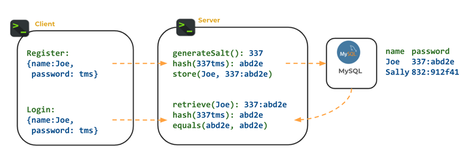

# Cryptographic Hashing

🖥️ [Slides](https://docs.google.com/presentation/d/1pUU4DDACUndgj_ij7bbKOUY8cxmGinZq/edit#slide=id.p1)

🖥️ [Lecture Videos](#videos)

📖 **Required Reading**: None

### 🔑 Key points

- Cryptographic hash functions
- Secure password storage and verification
- Bcrypt

---

Cryptographic hashing is a cornerstone of modern computer security, providing a robust mechanism for ensuring data integrity and verifying authenticity. By applying a mathematical algorithm to input data of any size, a hash function produces a unique, fixed-length character string known as a "digest" or "fingerprint." This process is vital for protecting sensitive information because it allows systems to confirm that data has not been tampered with; even a single-bit change in the original input results in a vastly different output. From securing password databases by storing hashes instead of plain text to validating the legitimacy of software downloads through digital signatures, cryptographic hashing serves as an essential safeguard against unauthorized modification and data breaches.

## Cryptographic Hash Functions

A hash function is a mathematical function that converts data of arbitrary size into a fixed-size value. The value returned by a hash function is often called a hash value, hash code, digest, or simply a hash.

Desirable features of a cryptographic hash function include:

- **Fixed-Size**: The digest (output) is always the same size (e.g., 256 bits), regardless of the input size.
- **Deterministic**: Given the same input, it always produces the same digest.
- **One-Way**: Given a digest, it is computationally infeasible to recover the original input.
- **Collision Resistance**: It should be extremely difficult to find two different input values that produce the same digest.
- **Preimage Resistance**: Given a digest, it should be difficult to find any input value that produces that specific digest.

There are many algorithms for computing digests. The following table lists common ones along with their limitations and benefits.

| Hash function | Benefits                                                               | Limitations                                                                |
| ------------- | ---------------------------------------------------------------------- | -------------------------------------------------------------------------- |
| **MD5**       | Simple, fast, widely available                                         | Vulnerable to collision attacks; considered insecure for cryptographic use |
| **SHA-1**     | Historically significant, widely available                             | Vulnerable to collision attacks; considered insecure for cryptographic use |
| **SHA-256**   | Secure against known attacks, industry standard                        | Slower than MD5 and SHA-1                                                  |
| **Bcrypt**    | Specifically designed for password hashing; secure against brute force | Intentionally slow; not suitable for general data integrity checks         |

If you are using macOS or Linux, you can use the `shasum` command-line utility to generate a hash using the **SHA-256** algorithm.

```sh
➜ echo -n "Fox" | shasum -a 256
f55bd2cdfae7972827638f3691a5bc189199d7cff7188d5ead489afdea0e5403
```

The following Java code demonstrates how to achieve the same result.

```java
package demo;

import java.security.MessageDigest;
import java.security.NoSuchAlgorithmException;
import java.nio.charset.StandardCharsets;

public class CryptoHashFunctionDemo {

    private static final char[] HEX_ARRAY = "0123456789abcdef".toCharArray();

    public static void main(String[] args) throws NoSuchAlgorithmException {

        String[] allInputs = new String[]{
                "Fox",
                "Fox",
                "The red fox jumps over the blue dog",
                "The red fox jumps oѵer the blue dog",
        };

        for (String input : allInputs) {
            // Convert character string to array of bytes
            byte[] inputBytes = input.getBytes(StandardCharsets.UTF_8);

            // Calculate message digest
            MessageDigest md = MessageDigest.getInstance("SHA-256");
            byte[] digestBytes = md.digest(inputBytes);

            System.out.println("Input: " + input);
            System.out.println("Hash:  " + bytesToHex(digestBytes));
            System.out.println();
        }
    }

    public static String bytesToHex(byte[] bytes) {
        char[] hexChars = new char[bytes.length * 2];
        for (int j = 0; j < bytes.length; j++) {
            int v = bytes[j] & 0xFF;
            hexChars[j * 2] = HEX_ARRAY[v >>> 4];
            hexChars[j * 2 + 1] = HEX_ARRAY[v & 0x0F];
        }
        return new String(hexChars);
    }
}
```

Both methods generate the same output for the word `Fox`. Notice that changing the case of the text or including whitespace will produce entirely different results.

### Creating Signatures

One primary use for a hash function is to create a unique, short, fixed-size signature that represents data blocks of arbitrary length. A signature acts as a compact representation of the data, allowing you to quickly determine if two blocks of data are identical.

Key properties for generating signatures include speed, fixed size, determinism, and collision resistance. While MD5 and SHA-1 are insecure for sensitive data, they are sometimes still used for non-security tasks like file identification. For example, Git uses SHA-1 to generate a unique signature for all data in a given commit.

### Securing Passwords

Because hash functions are one-way and preimage resistant, they are ideal for storing passwords. Under this model, you hash the user's password when they register and store only the hash in your database. To authenticate a user later, you hash the password they provide at login and compare it to the stored hash.

Storing hashes instead of plain text is vital. Consider a database storing passwords in plain text:

| User  | Password       |
| ----- | -------------- |
| sally | toomanysecrets |
| juan  | p@33w0r6       |
| pat   | qwerty1        |

If this database is compromised, the attacker gains every user's credentials. Because users often reuse passwords across different sites, a breach in your application could expose their bank accounts or email.

Hashing prevents attackers from simply reading passwords:

| User  | HashedPassword (SHA-1)                   |
| ----- | ---------------------------------------- |
| sally | fc80b22ff203a1a88470b19ab19228044d066d66 |
| juan  | adb4c36db0466b9750a7a298ef39f98159eb219d |
| pat   | ad70ab97ae1376e656002641cfb067c9c94906a2 |

However, an attacker can still use a **rainbow table attack**. A rainbow table is a large database of precomputed hash codes for millions of common passwords. If an attacker finds your stored hash in their table, they immediately know the original password.

To combat rainbow table attacks, we use a **salt**—a random sequence of characters added to the password before hashing. A unique salt for every user ensures that even if two users have the same password, their hashes will be different.

| User  | SaltedHashedPassword                           |
| ----- | ---------------------------------------------- |
| sally | 37581:a67d83d2f75f240fe223ea899757a6980dee7d50 |
| juan  | 92734:79241300a93bdda742159f1902db461b55be3982 |
| pat   | 84723:fdfa32ac48e82803daa5b2a0849fb3c080b09cec |

The following diagram demonstrates the flow for using salted passwords:



The salt does not need to be encrypted; it is stored in the database alongside the hash. It simply ensures that an attacker cannot use a generic rainbow table. They would have to compute a new table for every individual salt, which is computationally impractical.

| Representation    | Benefit                                                               |
| ----------------- | --------------------------------------------------------------------- |
| Plain text        | None (dangerous)                                                      |
| Hashed            | Passwords are not immediately readable if the database is compromised |
| Hashed and salted | Protects against precomputed rainbow table attacks                    |

### Bcrypt

To further protect passwords, we use hashing algorithms that are "expensive" to calculate. Modern hardware with Graphics Processing Units (GPUs) can compute millions of SHA-256 hashes per second. **Bcrypt** was created to be intentionally slow. While SHA-256 might check millions of passwords per second, Bcrypt might only check a few thousand on the same hardware. This "work factor" makes brute-force attacks much more difficult.

You can use the following library for Bcrypt in Java:

```
org.mindrot:jbcrypt:0.4
```

Bcrypt handles salting automatically. The following example hashes a password and then verifies it against candidates.

```java
import org.mindrot.jbcrypt.BCrypt;

public class PasswordExample {

    public static void main(String[] args) {
        String secret = "toomanysecrets";
        // gensalt() generates a random salt and includes the work factor
        String hash = BCrypt.hashpw(secret, BCrypt.gensalt());

        String[] passwords = {"cow", "toomanysecrets", "password"};
        for (var pw : passwords) {
            var match = BCrypt.checkpw(pw, hash) ? "==" : "!=";
            System.out.printf("%s %s %s%n", pw, match, secret);
        }
    }
}
```

## Videos

- 🎥 [Computer Security Overview (7:49)](https://byu.hosted.panopto.com/Panopto/Pages/Viewer.aspx?id=f60bd2e6-9aec-44ba-8e48-b1a8014a2efe) - [[transcript]](https://github.com/user-attachments/files/17736619/CS_240_Computer_Security_Overview_Transcript.pdf)
- 🎥 [Cryptographic Hash Functions (10:05)](https://byu.hosted.panopto.com/Panopto/Pages/Viewer.aspx?id=e54b188b-89a4-4f51-be13-b1a8014d0a7b) - [[transcript]](https://github.com/user-attachments/files/17736652/CS_240_Cryptographic_Hash_Functions_Transcript.pdf)
- 🎥 [Cryptographic Hashing Applications (5:29)](https://byu.hosted.panopto.com/Panopto/Pages/Viewer.aspx?id=44f59163-ab0a-410b-a8bb-b1a8015012bf) - [[transcript]](https://github.com/user-attachments/files/17736656/CS_240_Cryptographic_Hashing_Applications_Transcript.pdf)
- 🎥 [Secure Password Storage (15:06)](https://byu.hosted.panopto.com/Panopto/Pages/Viewer.aspx?id=f977577d-6fec-45a9-8e80-b1a80151efc1) - [[transcript]](https://github.com/user-attachments/files/17736661/CS_240_Secure_Password_Storage_Transcript.pdf)
