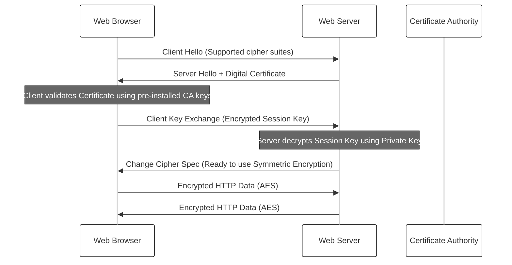

# Encryption

In the landscape of modern software engineering, security is not an optional feature but a foundational requirement. As systems become increasingly distributed and cloud-native, data must traverse untrusted networks, making it vulnerable to interception, tampering, and impersonation. Encryption is the primary tool architects use to ensure confidentiality, integrity, and authenticity. It is the mathematical shield that allows us to build a "web of trust" over a public infrastructure. By understanding the mechanics of how keys are generated, exchanged, and validated, developers can build systems that protect user privacy and maintain the integrity of sensitive data.

### Symmetric Encryption

Symmetric encryption is the oldest and most straightforward form of cryptography. In this model, a single "secret key" is used for both the encryption of the plaintext and the decryption of the resulting ciphertext. It functions much like a physical lock and key: the person locking the box and the person unlocking it must have an identical copy of the same key.

The primary advantage of symmetric encryption is its efficiency. Algorithms like the **Advanced Encryption Standard (AES)** are extremely fast and can be implemented in hardware, making them ideal for encrypting large volumes of data, such as database records or streaming video. However, symmetric encryption presents a significant architectural challenge: the key distribution problem. If two parties wish to communicate securely, they must first agree on a secret key. If they are on opposite sides of the world, how can they share that key without an eavesdropper intercepting it?

### Asymmetric Encryption

Asymmetric encryption, also known as Public Key Cryptography, solved the key distribution problem by introducing two mathematically related keys: the **Public Key** and the **Private Key**. 

*   **The Public Key** can be shared with anyone in the world. It is used to encrypt data.
*   **The Private Key** must be kept secret by the owner. It is the only key capable of decrypting data that was encrypted with the corresponding public key.

This creates a powerful paradigm: if Alice wants to send a secret message to Bob, she finds Bob’s public key and encrypts the message. Now, only Bob—the holder of the private key—can read it. Even Alice cannot decrypt the message once she has encrypted it. While asymmetric encryption (using algorithms like RSA or Elliptic Curve Cryptography) is mathematically elegant, it is computationally expensive—often hundreds or thousands of times slower than symmetric encryption. Consequently, it is rarely used to encrypt large datasets directly.

### Secure Key Exchange

In practice, software systems use a hybrid approach to get the "best of both worlds." They use asymmetric encryption to securely exchange a temporary symmetric key, and then use that symmetric key for the remainder of the session.

One common method is for the client to generate a random "session key," encrypt it using the server's public key, and send it to the server. Only the server can decrypt this session key. Once both parties have it, they switch to symmetric encryption for high-speed communication. Alternatively, the **Diffie-Hellman key exchange** allows two parties to jointly create a shared secret over an insecure channel without ever actually sending the key itself across the wire.

### Digital Signatures and Integrity

Encryption protects confidentiality, but how do we ensure that a message hasn't been altered in transit? Digital signatures provide a way to verify both the **integrity** of the data and the **authenticity** of the sender.

To sign a document, the sender creates a "hash" (a unique digital fingerprint) of the message and encrypts that hash using their own **private key**. The receiver then decrypts the hash using the sender's **public key** and compares it to a fresh hash they generate from the message. If the hashes match, the receiver knows two things: the message was not modified, and it must have been sent by the owner of the private key.

### Public Key Certificates and Trust

Asymmetric encryption relies on the assumption that you are using the *correct* public key. If an attacker replaces a server's public key with their own, they could intercept and decrypt your traffic. To prevent this, we use **Public Key Certificates**.

A certificate is a digital document that binds a public key to an identity (like a website domain). These certificates are issued by **Certificate Authorities (CAs)**—trusted third parties like Let's Encrypt or DigiCert. Your web browser comes pre-installed with a list of "Root Certificates" from these trusted authorities. When you visit a site, the server presents its certificate; your browser checks the CA’s digital signature to verify the certificate is legitimate.

### HTTPS: Putting It All Together

Hypertext Transfer Protocol Secure (HTTPS) is the implementation of Transport Layer Security (TLS) over HTTP. It uses every concept discussed above to secure the web. When you connect to a website via HTTPS, a "handshake" occurs to establish a secure connection.

In this flow, asymmetric encryption (the certificate) is used to verify the server's identity and exchange a session key. Once the handshake is complete, symmetric encryption (AES) takes over to ensure the actual web content is transmitted quickly and securely.

### Common Challenges and Solutions

Implementing encryption is rarely about writing the algorithms from scratch—it is about managing them correctly.

*   **Key Management:** The most common point of failure is not the math, but the storage of keys. Hardcoding a private key in source code is a critical error. **Solution:** Use dedicated Key Management Systems (KMS) or Vaults (like AWS KMS or HashiCorp Vault) to rotate and protect secrets.
*   **Performance Overhead:** Asymmetric operations can slow down initial connection times (latency). **Solution:** Use "Session Resumption" and modern protocols like TLS 1.3, which reduce the number of round-trips required for a handshake.
*   **Expired Certificates:** If a certificate expires, users will see a "Your connection is not private" warning, breaking trust. **Solution:** Use automated tools like ACME (used by Let's Encrypt) to automatically renew certificates before they expire.

### Summary

Encryption is a multi-layered discipline that secures the modern internet. Symmetric encryption provides the speed necessary for high-volume data transfer, while asymmetric encryption solves the problem of trusting strangers over a network. By combining these with digital signatures and a hierarchy of certificate authorities, we create the HTTPS protocol that protects our daily digital interactions. For a software engineer, the goal is to understand these patterns so that security can be baked into the architecture of an application from day one, rather than being bolted on as an afterthought.

For further exploration of these concepts, the [OWASP Transport Layer Protection Cheat Sheet](https://cheatsheetseries.owasp.org/cheatsheets/Transport_Layer_Protection_Cheat_Sheet.html) provides excellent practical implementation advice for developers.