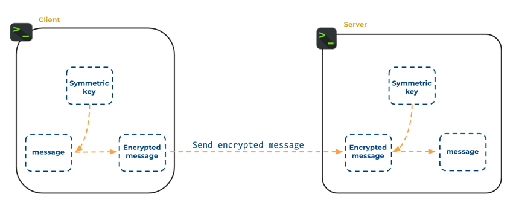
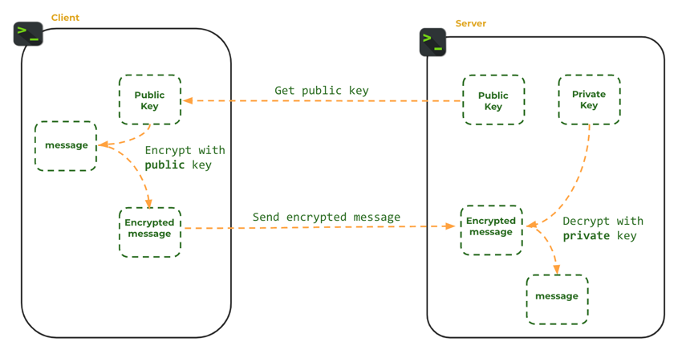
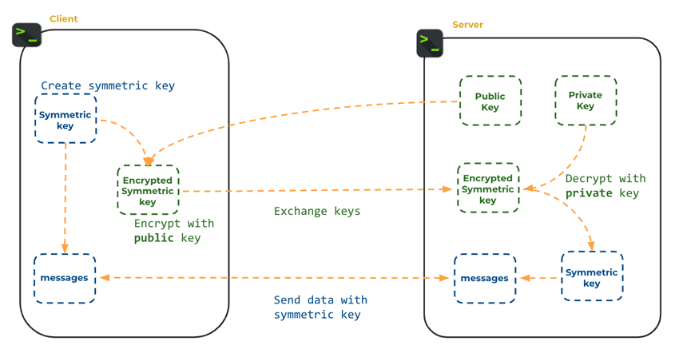
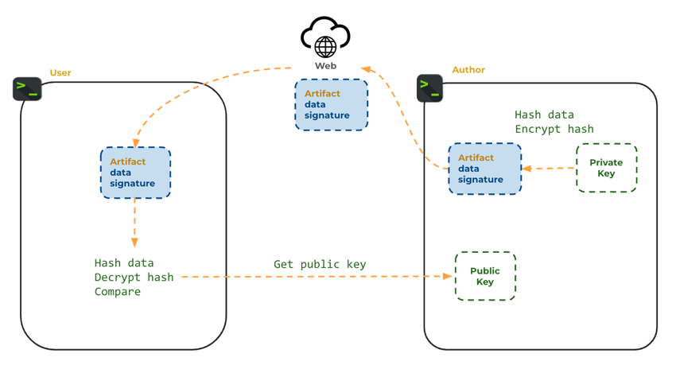
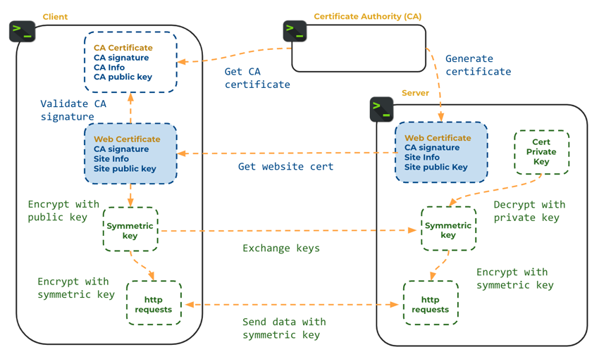

# Encryption

🖥️ [Slides](https://docs.google.com/presentation/d/1pUU4DDACUndgj_ij7bbKOUY8cxmGinZq/edit#slide=id.p1)

🖥️ [Lecture Videos](#videos)

📖 **Required Reading**: None

### 🔑 Key points

- Symmetric encryption
- Asymmetric encryption with public and private keys
- Secure key exchange
- Digital signatures
- Public key certificates
- Secure network communication using HTTPS

---

In the landscape of modern software engineering, security is not an optional feature but a foundational requirement. As systems become increasingly distributed and cloud-native, data must traverse untrusted networks, making it vulnerable to interception, tampering, and impersonation. Encryption is the primary tool architects use to ensure confidentiality, integrity, and authenticity. It is the mathematical shield that allows us to build a "web of trust" over a public infrastructure. By understanding the mechanics of how keys are generated, exchanged, and validated, developers can build systems that protect user privacy and maintain the integrity of sensitive data.

## Encryption and Decryption

**Encryption** is the process of encoding data so that it is unreadable to unauthorized parties. **Decryption** is the process of reverting encoded data back to its original form.

Unlike one-way hashing, many applications need to recover the original data. For example, medical or financial records must be encrypted for storage but decrypted when a user requests to view them.

| Term       | Purpose                                | Example             |
| ---------- | -------------------------------------- | ------------------- |
| Plaintext  | Unencrypted data                       | toomanysecrets      |
| Key        | Value used to encrypt and decrypt data | 9012434289054653828 |
| Key size   | The length of the key (in bits)        | 256 bits            |
| Ciphertext | Encrypted data                         | 88338012387532      |

### Simple Example

Consider a simple "Caesar cipher" variation that adds a numeric key to each character.

| Value      | Example        |
| ---------- | -------------- |
| Plaintext  | toomanysecrets |
| Key        | 1              |
| Ciphertext | uppoboztfdsfut |

```java
public class SimpleExample {
  public static void main(String[] args) {
      var key = 1;
      var plainText = "toomanysecrets".toCharArray();

      // encrypt
      var cipherText = new char[plainText.length];
      for (var i = 0; i < plainText.length; i++) {
          cipherText[i] = (char) (plainText[i] + key);
      }

      // decrypt
      var decryptedText = new char[cipherText.length];
      for (var i = 0; i < cipherText.length; i++) {
          decryptedText[i] = (char) (cipherText[i] - key);
      }

      System.out.println(decryptedText);
      System.out.println(cipherText);
  }
}
```

This is easily defeated because there are only a few possible keys. Secure algorithms use large keys and complex mathematics. A key size of 1024 bits provides **2^1024** possible combinations—a number larger than the estimated number of atoms in the observable universe (**10^80**).

## Symmetric Key Encryption

Symmetric encryption uses the same key for both encryption and decryption. These algorithms are very fast and provide strong security if the key is kept secret.

A common symmetric algorithm is the Advanced Encryption Standard (**AES**). AES uses an **initialization vector (IV)** to ensure that encrypting the same plaintext twice results in different ciphertext, preventing attackers from identifying patterns in the encrypted data.



The following code demonstrates AES encryption and decryption in Java:

```java
import javax.crypto.*;
import javax.crypto.spec.IvParameterSpec;
import java.security.SecureRandom;
import java.io.*;

public class SymmetricKeyExample {
    public static void main(String[] args) throws Exception {
        SecretKey key = createAesKey();
        IvParameterSpec initVector = createAesInitVector();

        var secretMessage = "toomanysecrets";

        var plainTextIn = new ByteArrayInputStream(secretMessage.getBytes());
        var cipherBytes = runAes(Cipher.ENCRYPT_MODE, plainTextIn, key, initVector);

        var cipherTextIn = new ByteArrayInputStream(cipherBytes);
        var plainTextBytes = runAes(Cipher.DECRYPT_MODE, cipherTextIn, key, initVector);

        System.out.printf("%s == %s%n", secretMessage, new String(plainTextBytes));
    }

    static SecretKey createAesKey() throws Exception {
        KeyGenerator keyGen = KeyGenerator.getInstance("AES");
        keyGen.init(256);
        return keyGen.generateKey();
    }

    static IvParameterSpec createAesInitVector() {
        var ivBytes = new byte[16];
        new SecureRandom().nextBytes(ivBytes);
        return new IvParameterSpec(ivBytes);
    }

    static byte[] runAes(int cipherMode, InputStream in, SecretKey key, IvParameterSpec initVector) throws Exception {
        Cipher cipher = Cipher.getInstance("AES/CBC/PKCS5Padding");
        cipher.init(cipherMode, key, initVector);

        ByteArrayOutputStream out = new ByteArrayOutputStream();
        byte[] inputBytes = new byte[64];
        int bytesRead;
        while ((bytesRead = in.read(inputBytes)) != -1) {
            out.write(cipher.update(inputBytes, 0, bytesRead));
        }

        out.write(cipher.doFinal());
        return out.toByteArray();
    }
}
```

### Asymmetric Key Encryption

Asymmetric encryption uses a **key pair**: a **public key** and a **private key**. Data encrypted with the public key can only be decrypted with the corresponding private key.

1. Generate a key pair.
2. Keep the **private key** secret.
3. Distribute the **public key** to anyone who wants to send you data.
4. The sender encrypts data using your public key.
5. You decrypt the data using your private key.



Popular implementations include:

- **RSA (Rivest–Shamir–Adleman)**: A mature, widely used algorithm for secure communication and digital signatures.
- **ECC (Elliptic Curve Cryptography)**: A newer algorithm that is more efficient than RSA, offering similar security with smaller key sizes—ideal for mobile devices.

```java
import javax.crypto.Cipher;
import java.io.*;
import java.security.*;

public class AsymmetricKeyExample {
    public static void main(String[] args) throws Exception {
        KeyPair keyPair = createRsaKeyPair();

        final String secretMessage = "toomanysecrets";

        var plainTextIn = new ByteArrayInputStream(secretMessage.getBytes());
        var cipherTextOut = new ByteArrayOutputStream();
        runRsa(Cipher.ENCRYPT_MODE, plainTextIn, cipherTextOut, keyPair.getPublic());

        var cipherTextIn = new ByteArrayInputStream(cipherTextOut.toByteArray());
        var plainTextOut = new ByteArrayOutputStream();
        runRsa(Cipher.DECRYPT_MODE, cipherTextIn, plainTextOut, keyPair.getPrivate());

        System.out.printf("%s == %s%n", secretMessage, plainTextOut);
    }

    private static KeyPair createRsaKeyPair() throws Exception {
        var keyPairGen = KeyPairGenerator.getInstance("RSA");
        keyPairGen.initialize(2048);
        return keyPairGen.generateKeyPair();
    }

    private static void runRsa(int cipherMode, InputStream inputStream, OutputStream outputStream, Key key) throws Exception {
        Cipher cipher = Cipher.getInstance("RSA");
        cipher.init(cipherMode, key);

        byte[] inputBytes = new byte[64];
        int bytesRead;
        while ((bytesRead = inputStream.read(inputBytes)) != -1) {
            outputStream.write(cipher.update(inputBytes, 0, bytesRead));
        }

        outputStream.write(cipher.doFinal());
    }
}
```

You can also generate an RSA key pair using the terminal:

```sh
ssh-keygen -t rsa -b 4096
```

```masteryls
{"id":"72e7da2d-4755-40ef-bcc6-cd3c0ebee3c0","title":"Advantages of Symmetric Encryption","type":"multiple-choice"}
When comparing symmetric and asymmetric cryptographic systems, which of the following represents a significant advantage of symmetric encryption?

- [ ] It provides a native solution for the key distribution problem when communicating with unknown parties over the internet.
  You're thinking about the key distribution problem, which is one of the most important ideas in this lesson.

  Symmetric encryption is actually the one that *has* that problem, though. Both parties need the same secret key, and getting it to them securely is hard.

  Reread the *Secure Key Exchange* section and notice which type of encryption is used to solve this problem.

- [ ] It inherently supports digital signatures, providing non-repudiation for all transmitted messages.
  Good effort. Digital signatures and non-repudiation are important security properties.

  Signatures depend on a key **pair**, though: a private key that only the signer has and a public key anyone can use to verify. With a single shared key, either party could have produced the message.

  Revisit the *Digital Signatures* section and notice which keys Sally and Juan use.

- [x] It offers significantly higher processing speeds and lower computational overhead, making it ideal for bulk data encryption.
  **Correct!** Symmetric algorithms like AES are very fast and efficient.

  That's why real systems use a hybrid approach. Asymmetric encryption securely exchanges a symmetric key, and then the symmetric key encrypts the bulk of the data. You can see this pattern in the HTTPS handshake at the end of the lesson.

- [ ] It simplifies key management in large networks by requiring only one pair of keys for every user.
  You're thinking about key management at scale, which is a real challenge.

  A "pair of keys for every user" describes **asymmetric** encryption, though. With symmetric encryption, every pair of parties needs its own shared secret, which gets harder to manage as a network grows.

  Compare the *Symmetric Key Encryption* and *Asymmetric Key Encryption* sections.
```

### Disadvantages of Asymmetric Key Encryption

Asymmetric encryption is critical for modern security, but it has two main drawbacks:

1. **Size Restriction**: It can only encrypt small amounts of data (typically smaller than the key size).
2. **Performance**: It is significantly slower than symmetric encryption.

## Secure Key Exchange

Symmetric encryption requires both parties to share the same key. Securely getting that key to a remote party is a classic problem. We solve this using a hybrid approach: **asymmetric encryption** is used to securely exchange a **symmetric key**.

1. The Client generates an asymmetric key pair and shares the public key.
2. The Server generates a symmetric key and encrypts it using the Client's public key.
3. The Server sends the encrypted symmetric key to the Client.
4. The Client decrypts it using their private key.
5. Both parties now have the same symmetric key and use it for fast, secure communication.



## Digital Signatures

Digital signatures provide **non-repudiation** and **data integrity**. They prove that a message was sent by a specific author and has not been tampered with.

1. Sally generates an asymmetric key pair and shares her public key.
2. Sally hashes her message (e.g., using SHA-256).
3. Sally encrypts the hash using her **private key**. This encrypted hash is the **digital signature**.
4. Sally sends the message and the signature.
5. Juan receives the message and hashes it himself.
6. Juan decrypts the signature using Sally's **public key**.
7. If Juan's hash matches the decrypted signature, he knows the message is authentic and unchanged.



```masteryls
{"id":"c1c21706-2c8e-406e-a54d-62695cab0c42","title":"Role of Hashing in Digital Signatures","type":"multiple-choice"}
In the process of creating a digital signature, what is the primary purpose of applying a cryptographic hash function to the original message before it is encrypted with a private key?

- [ ] To provide confidentiality by ensuring that the message content remains hidden from any unauthorized third parties during transit.
  Good effort. Confidentiality is an important security goal.

  A digital signature doesn't hide the message, though. Sally sends the message along with the signature, and anyone can read it. Signatures prove *who* sent a message and that it *hasn't changed*.

  Reread the first sentence of the *Digital Signatures* section.

- [ ] To generate a shared symmetric key that both the sender and receiver will use to encrypt and decrypt the bulk of the message data.
  You're connecting this to the hybrid approach, where a symmetric key protects bulk data. That's a real pattern.

  It belongs to *key exchange*, though, not digital signatures. In a signature, the hash is compared, not used as a key.

  Revisit the steps in the *Digital Signatures* section and follow what happens to the hash.

- [x] To produce a unique, fixed-size digest that allows the receiver to verify the integrity of the message by detecting any unauthorized modifications.
  **Exactly right!** The hash is a compact fingerprint of the message.

  Sally encrypts the hash with her private key. Juan hashes the message himself and compares his result with the decrypted signature. If even one character changed, the hashes won't match. Hashing first also keeps the slow asymmetric step small, because a digest is much shorter than the full message.

- [ ] To increase the total length of the data string to ensure it meets the minimum bit-length requirements for asymmetric encryption algorithms.
  Good effort. Asymmetric algorithms do have size limits.

  Hash functions produce a *fixed-size* output, though, often much smaller than the original message. The point isn't to make the data longer; it's to create a fingerprint that reveals any change.

  Reread the *Cryptographic Hash Functions* section and the properties it lists.
```

## Web Certificates and HTTPS

HTTPS (Hypertext Transfer Protocol Secure) combines these concepts to secure the web.

Browsers trust **Certificate Authorities (CAs)**. A website owner proves their identity to a CA, which then issues a **web certificate**. This certificate contains the website's identity, its public key, and a digital signature from the CA.

1. A browser connects to a website.
2. The website sends its certificate.
3. The browser verifies the CA's signature to ensure the certificate is valid.
4. The browser generates a random symmetric key, encrypts it with the website's public key, and sends it to the website.
5. The website decrypts the key using its private key.
6. All further communication is encrypted using that symmetric key.



If the website cannot decrypt the symmetric key, it proves they do not own the private key associated with the certificate, and the browser terminates the connection.

```masteryls
{"id":"848391d2-e265-4d53-ad15-a55fc760547c", "title":"Web Certificates", "type":"essay", "gradingCriteria":"- Addresses the prompt directly\n- Uses at least one concrete example\n- Demonstrates accurate understanding of key concepts\n- Complete coverage of the topic is not necessary for full credit." }
You are analyzing the security of your web application. Where would an attacker gain the most value from compromising the web certificate generation and use?
```

## Videos

- 🎥 [Data Encryption (4:27)](https://byu.hosted.panopto.com/Panopto/Pages/Viewer.aspx?id=bd28a2d9-adec-4c2b-b78f-b1a8015667b9) - [[transcript]](https://github.com/user-attachments/files/17736672/CS_240_Data_Encryption_Transcript.pdf)
- 🎥 [Symmetric Key Encryption (11:37)](https://byu.hosted.panopto.com/Panopto/Pages/Viewer.aspx?id=0537f4f0-5ef2-4534-9564-b1a80157e780) - [[transcript]](https://github.com/user-attachments/files/17736680/CS_240_Symmetric_Key_Encryption_Transcript.pdf)
- 🎥 [Asymmetric Key Encryption (15:01)](https://byu.hosted.panopto.com/Panopto/Pages/Viewer.aspx?id=aad832e9-0621-4a6d-b389-b1a8015b6ffc) - [[transcript]](https://github.com/user-attachments/files/17736687/CS_240_Asymmetric_Key_Encryption_Transcript.pdf)
- 🎥 [Encryption Applications (6:28)](https://byu.hosted.panopto.com/Panopto/Pages/Viewer.aspx?id=cb8ef70e-52fd-4390-9ae9-b1a8015fcac1) - [[transcript]](https://github.com/user-attachments/files/17736710/CS_240_Encryption_Applications_Transcript.pdf)
- 🎥 [Secure Key Exchange (4:51)](https://byu.hosted.panopto.com/Panopto/Pages/Viewer.aspx?id=a466805a-7a15-4859-b84e-b1af0148e79d) - [[transcript]](https://github.com/user-attachments/files/17736726/CS_240_Secure_Key_Exchange_Transcript.pdf)
- 🎥 [Secure Communication with HTTPS (14:17)](https://byu.hosted.panopto.com/Panopto/Pages/Viewer.aspx?id=f02e79ed-fcca-4549-a8b7-b1af014aa782) - [[transcript]](https://github.com/user-attachments/files/17736732/CS_240_Secure_Communication_using_HTTPS_Transcript.pdf)
- 🎥 [Digital Signatures (8:10)](https://byu.hosted.panopto.com/Panopto/Pages/Viewer.aspx?id=93205b28-04ef-4e11-b939-b1af014ef686) - [[transcript]](https://github.com/user-attachments/files/17736735/CS_240_Digital_Signatures_Transcript.pdf)
